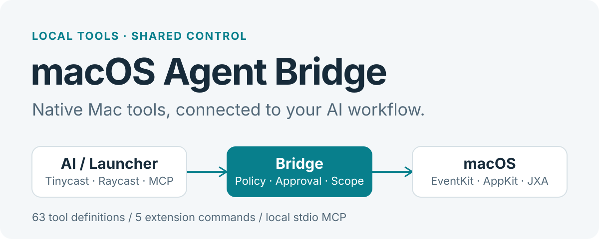

<p align="center">
  
</p>

<p align="center">
  <a href="README.md">简体中文</a> · <strong>English</strong>
</p>

<p align="center">
  <a href="https://github.com/juliusloon/macos-agent-bridge/releases/tag/v0.2.0"></a>
  <a href="https://github.com/juliusloon/macos-agent-bridge/actions/workflows/ci.yml"></a>
  <a href="LICENSE"></a>
</p>

# macOS Agent Bridge

Give AI agents **MCP access to your Mac's calendars, reminders, files and desktop tools**, with a Tinycast / Raycast extension to manage capabilities, permissions, pending actions and audit records. Standalone MCP clients use the same tools.

**63 tool definitions · 5 extension commands · Runs locally.** The tool count is not a claim that every capability has passed testing on a real Mac. See the [capability matrix](docs/CAPABILITY_COVERAGE.md) for individual status.

[Download v0.2.0](https://github.com/juliusloon/macos-agent-bridge/releases/tag/v0.2.0) · [Quick start](#quick-start) · [Capabilities and limits](#capabilities-and-limits) · [Security](docs/SECURITY.md)

## Start with one call

After installing and connecting MCP, try this in Tinycast AI Chat:

> @macos-bridge Read only the system time zone and uptime.

You can also ask an agent to list calendars, find free time in a specific range, or search and read public webpages. Calendar access and other protected resources need the corresponding macOS permissions; web tools require a network connection.

Developers can call the same MCP tool directly:

```json
{"name":"system_status","arguments":{}}
```

Every call returns `ok`, `error` or `confirmation_required`. **A pending action has not executed.** Review its exact arguments in the extension and approve it; the agent can then retrieve the result using the original idempotency key.

## Quick start

> **v0.2.0 is the initial public development release.** The prebuilt package targets Apple Silicon. Its helper is ad-hoc signed and has not undergone Developer ID notarization or store review. macOS may block the first launch; see [distribution and security](docs/SECURITY.md), or build from source.

### 1. Install the runtime components

Download `macos-agent-bridge-macos-arm64.zip` and `SHA256SUMS` from the [Release](https://github.com/juliusloon/macos-agent-bridge/releases/tag/v0.2.0). Verify them in your download directory, then extract the archive:

```sh
shasum -a 256 -c SHA256SUMS
```

Run **`Install.command`** inside the extracted directory. The package includes Node, the Swift helper and the built extension; a separate Node or Swift installation is unnecessary.

<details>
<summary>Build and install from source</summary>

Requires **macOS 14+, Node.js 22+, and Xcode Command Line Tools / Swift**. Your launcher must also meet its own system requirements.

```sh
git clone https://github.com/juliusloon/macos-agent-bridge.git
cd macos-agent-bridge
npm ci
npm run install:local
```

The installer builds the components and generates extension and MCP configuration for the current user. Quit **MacOS Agent Bridge Helper** before reinstalling.

</details>

### 2. Import the management extension

- **Tinycast:** Settings → Extensions → Add from folder. Select `Extension/` from the package, or `raycast-extension/dist/` after a source install.
- **Raycast:** Use Import Extension with the `raycast-extension/` source directory. Set **Bridge launcher** in the extension preferences to the installed `bridge` file.

Available commands:

| Command | Purpose |
| --- | --- |
| **macOS Agent Bridge** | Manage capabilities, file scope, automatic approval and system permissions |
| **Review Agent Actions** | Inspect arguments, approve and execute, or reject |
| **Agent Bridge Activity** | View redacted operation status records |
| **Bridge Calendar** | Preview the next seven days |
| **Connect Tinycast AI Chat** | Copy MCP configuration for the current user |

### 3. Connect MCP

Copy the configuration from **Connect Tinycast AI Chat**. In Tinycast, open Settings → AI → MCP Servers, select **Command**, enter the generated launcher path and set Arguments to **`--serve`**. The connection test should discover **63 tools**.

**Importing the extension and connecting MCP are separate steps.** The management view does not need to stay open. Tinycast AI Chat needs a model connection that supports MCP tools.

Other MCP clients use the same stdio configuration:

```json
{
  "mcpServers": {
    "macos-agent-bridge": {
      "command": "/Users/<username>/Library/Application Support/MacOSAgentBridge/bridge",
      "args": ["--serve"]
    }
  }
}
```

This path is a placeholder, not a ready-to-use value. Copy the real configuration from the extension; a source install also generates `docs/mcp-client.json`. Do not assume your MCP client expands `~` or environment variables.

## Capabilities and limits

| Group | Interfaces and scope |
| --- | --- |
| Calendar and Reminders | EventKit listing, queries and write interfaces; explicit UTC offsets and time zones |
| Files | Search, text reads and writes, copy, move and related operations within authorized roots |
| Desktop and system | Apps, current clipboard, windows, screenshots and fixed read-only system commands |
| Apple apps | Contacts; fixed public scripting interfaces for Notes, Mail, Safari and Music |
| Shortcuts | List and run installed Shortcuts; execution always requires approval |
| Public web | `web_search`, `web_fetch`, `network_check` |

These describe the available interfaces. Contacts, Accessibility, screenshots and some application writes still have permission or validation limits. The [capability matrix](docs/CAPABILITY_COVERAGE.md) records the detailed support status.

The bridge does **not** expose arbitrary shell, AppleScript or JavaScript execution. It does not read Raycast's private Clipboard History, Notes, Snippets or Quicklinks databases.

## Writes, permissions and privacy

- **Writes require approval by default.** Users can enable automatic approval for ordinary writes or trust specific capabilities. High-risk actions such as deletion, sending mail and running Shortcuts still require explicit approval.
- **Retries keep the same idempotency key.** Approval binds the tool, arguments and client source. An uncertain result must be inspected before another write is attempted.
- **Files have an explicit scope.** The default workspace is `~/Documents/Agent Bridge Workspace`; the entire home directory is not automatically authorized.
- **Local communication and state.** MCP uses stdio; the Swift helper uses a Unix socket for the current user. Audit logs record status rather than content or arguments. Pending arguments and short-lived operation results are stored in local state.
- **Web access has defined boundaries.** Web tools do not read browser cookies or execute webpage scripts. Search queries and requested URLs are sent to the relevant services. The selected AI client determines how it handles tool results.

macOS permissions, the launcher's MCP trust settings and Bridge action approval apply independently. See [security and data retention](docs/SECURITY.md) for the detailed boundaries.

## Development and validation

```sh
npm run check
npm test
npm run build
npm run build:native
npm run build:extension
```

Native behavior depends on system permissions, application accounts and host support. Passing automated tests does not establish successful real-device testing of every native read and write. See the [validation scope](docs/ACCEPTANCE.md).

The detailed documentation is maintained primarily in Chinese:

| Document | Contents |
| --- | --- |
| [Architecture](docs/ARCHITECTURE.md) | MCP, the shared execution engine and Swift helper |
| [Tinycast setup](docs/TINYCAST.md) | Import, MCP connection and approval workflow |
| [Capability matrix](docs/CAPABILITY_COVERAGE.md) | Per-tool status, permissions and limits |
| [Security and data retention](docs/SECURITY.md) | Approval, file boundaries, local state and release signing |
| [0.2.0 notes](docs/OPTIMIZATION-0.2.0.md) | Automatic approval, web tools and operation status |
| [Third-party notices](docs/THIRD_PARTY_NOTICES.md) | Runtime and dependency licenses |
| [Contributing](CONTRIBUTING.md) · [Security reports](SECURITY.md) · [Changelog](CHANGELOG.md) | Development, vulnerability reports and release history |

Reproducible bug reports and improvements are welcome through [Issues](https://github.com/juliusloon/macos-agent-bridge/issues). Use placeholder data in reports; do not upload calendars, contacts, email bodies or your complete local state directory.

## License

[MIT](LICENSE) © 2026 Cano and contributors. Third-party components retain their own licenses.
