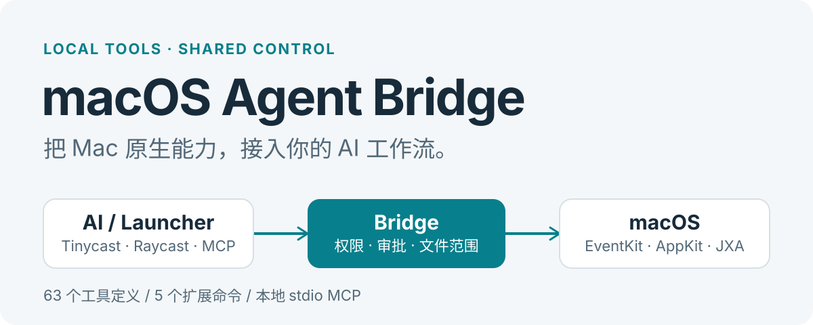

<p align="center">
  
</p>

<p align="center">
  <strong>简体中文</strong> · <a href="README-EN.md">English</a>
</p>

<p align="center">
  <a href="https://github.com/juliusloon/macos-agent-bridge/releases/tag/v0.3.0"></a>
  <a href="https://github.com/juliusloon/macos-agent-bridge/actions/workflows/ci.yml"></a>
  <a href="LICENSE"></a>
</p>

# macOS Agent Bridge

让 AI 通过 **MCP 调用 Mac 的日历、提醒事项、文件和桌面能力**，在 Tinycast / Raycast 扩展中统一管理能力开关、权限、待确认操作与审计记录。独立 MCP 客户端也能使用同一套工具。

**63 个工具定义 · 5 个扩展命令 · 本地运行**。工具数量不等于全部能力均已实机验收，逐项状态见[能力覆盖矩阵](docs/CAPABILITY_COVERAGE.md)。

[下载 v0.3.0](https://github.com/juliusloon/macos-agent-bridge/releases/tag/v0.3.0) · [快速开始](#快速开始) · [能力与边界](#能力与边界) · [安全说明](docs/SECURITY.md)

## 从一次调用开始

完成安装与 MCP 连接后，在 Tinycast AI Chat 中试试：

> @macos-bridge 查询当前本地日期、时间、时区和系统运行时间。

也可以让 Agent 列出可用日历、查询指定时间段的空闲，或搜索并读取公开网页。日历等资源需要对应的 macOS 权限；联网工具需要网络连接。

开发者可直接调用同名 MCP 工具：

```json
{"name":"system_status","arguments":{}}
```

`system_status` 直接读取本机时钟，返回 `localDate`、带 UTC 偏移的 `localTime`、UTC `currentTime`、IANA `timezone` 和 `unixTimeMs`，不需要联网、Helper 或系统授权。处理“今天晚上”“明天”时先调用它。网页获取失败时，查看错误中的 `phase`、`causeCode` 和 `hint`。系统 DNS 异常时默认回退到 Cloudflare HTTPS DNS，仅发送域名，可通过 `BRIDGE_DNS_FALLBACK=off` 关闭；详见[日期与联网故障排查](docs/NETWORK-TROUBLESHOOTING.md)。

所有调用返回统一的 `ok`、`error` 或 `confirmation_required` 状态。**待确认表示尚未执行**；在扩展里审阅参数并批准后，Agent 可用原幂等键取得结果。

## 快速开始

> **v0.3.0 为公开开发版本。** 预构建包面向 Apple Silicon，Helper 使用 ad-hoc 签名，尚未完成 Developer ID 公证或商店审核。macOS 可能阻止首次打开；参阅[发行与安全说明](docs/SECURITY.md)，也可选择从源码构建。

### 1. 安装运行组件

从 [Release](https://github.com/juliusloon/macos-agent-bridge/releases/tag/v0.3.0) 下载 `macos-agent-bridge-macos-arm64.zip` 和 `SHA256SUMS`，在下载目录校验后解压：

```sh
shasum -a 256 -c SHA256SUMS
```

运行解压目录中的 **`Install.command`**。安装包包含 Node 运行时、Swift Helper 和已构建扩展，无需另外安装 Node 或 Swift。

<details>
<summary>从源码构建与安装</summary>

需要 **macOS 14+、Node.js 22+、Xcode Command Line Tools / Swift**；使用的启动器还需满足自身系统要求。

```sh
git clone https://github.com/juliusloon/macos-agent-bridge.git
cd macos-agent-bridge
npm ci
npm run install:local
```

安装器编译运行组件，并为当前用户生成扩展与 MCP 配置。重新安装前，先退出正在运行的 **MacOS Agent Bridge Helper**。

</details>

### 2. 导入管理扩展

- **Tinycast**：Settings → Extensions → Add from folder，选择安装包内的 `Extension/`；源码安装选择 `raycast-extension/dist/`。
- **Raycast**：Import Extension 选择 `raycast-extension/` 源码目录。在扩展设置中将 **Bridge launcher** 指向已安装的 `bridge` 文件。

安装后的入口：

| 命令 | 用途 |
| --- | --- |
| **macOS Agent Bridge** | 管理能力、文件范围、自动批准与系统权限 |
| **Review Agent Actions** | 审阅具体参数，批准并执行或拒绝 |
| **Agent Bridge Activity** | 查看脱敏的操作状态记录 |
| **Bridge Calendar** | 预览未来七天日程 |
| **Connect Tinycast AI Chat** | 复制当前用户的 MCP 配置 |

### 3. 连接 MCP

在 **Connect Tinycast AI Chat** 中复制配置。Tinycast 的入口为 Settings → AI → MCP Servers：Connection 选 **Command**，填入安装器生成的启动路径，Arguments 填 **`--serve`**。测试连接应发现 **63 个工具**。

**导入扩展与连接 MCP 是两个步骤。** 服务启动后无需持续打开管理界面；Tinycast AI Chat 需使用支持 MCP 工具的模型连接。

其他 MCP 客户端使用相同的 stdio 配置：

```json
{
  "mcpServers": {
    "macos-agent-bridge": {
      "command": "/Users/<用户名>/Library/Application Support/MacOSAgentBridge/bridge",
      "args": ["--serve"]
    }
  }
}
```

上方路径是占位示例，不能直接粘贴使用。优先复制扩展提供的真实配置；源码安装也会生成 `docs/mcp-client.json`。不要假设 MCP 客户端会自动展开 `~` 或环境变量。

## 能力与边界

| 能力组 | 接入内容与范围 |
| --- | --- |
| 日历与提醒事项 | EventKit 列表、查询与写入接口；时间参数明确 UTC 偏移和时区 |
| 文件 | 仅用户授权根目录内的搜索、文本读写、复制与移动等操作 |
| 桌面与系统 | 应用、当前剪贴板、窗口、截图及固定只读系统命令 |
| Apple 应用 | Contacts；Notes、Mail、Safari、Music 的固定公开脚本接口 |
| 快捷指令 | 枚举和运行已安装的 Shortcuts；执行始终需要确认 |
| 公网工具 | `web_search`、`web_fetch`、`network_check` |

这些是接口范围；Contacts、Accessibility、截图及部分应用写入仍有权限或验收限制。完整支持状态与限制以[覆盖矩阵](docs/CAPABILITY_COVERAGE.md)为准。

**不提供**任意 shell、任意 AppleScript / JavaScript 执行，也不读取 Raycast 私有的 Clipboard History、Notes、Snippets 或 Quicklinks 数据库。

## 写入、权限与隐私

- **默认逐次审批写入。** 用户可开启普通写入自动批准或信任指定能力；删除、发送邮件、运行快捷指令等高风险操作仍需明确批准。
- **重试沿用同一幂等键。** 审批绑定具体工具、参数和来源；不确定的执行结果需先核实，避免重复写入。
- **文件访问有范围。** 默认工作目录为 `~/Documents/Agent Bridge Workspace`，不会自动授权整个主目录。
- **本地通信与状态。** MCP 使用 stdio；Swift Helper 使用当前用户的 Unix socket。审计日志记录状态，不记录正文或参数；待审批参数与短期执行结果会保存在本地状态中。
- **联网有明确边界。** 公网工具不读取浏览器 Cookie，不执行网页脚本；搜索词和请求 URL 会发送给相应服务。选定的 AI 客户端如何处理工具结果，由该客户端决定。

macOS 系统授权、启动器的 MCP 信任设置、Bridge 的动作审批分别生效。详细保存规则与威胁边界见[安全说明](docs/SECURITY.md)。

## 开发与验证

```sh
npm run check
npm test
npm run build
npm run build:native
npm run build:extension
```

原生工具的实际行为取决于系统权限、应用账户与宿主支持。自动测试通过不代表全部原生读写已经实机验证；公开验证范围见[验收说明](docs/ACCEPTANCE.md)。

| 文档 | 内容 |
| --- | --- |
| [架构](docs/ARCHITECTURE.md) | MCP、共享执行引擎与 Swift Helper |
| [Tinycast 接入](docs/TINYCAST.md) | 导入、MCP 连接和审批流程 |
| [能力覆盖矩阵](docs/CAPABILITY_COVERAGE.md) | 逐工具状态、权限、限制 |
| [安全与数据保存](docs/SECURITY.md) | 审批、文件边界、本地数据、发行签名 |
| [0.2.0 更新说明](docs/OPTIMIZATION-0.2.0.md) | 自动批准、联网与操作状态查询 |
| [第三方组件](docs/THIRD_PARTY_NOTICES.md) | 运行时与依赖许可证 |
| [贡献指南](CONTRIBUTING.md) · [安全报告](SECURITY.md) · [变更日志](CHANGELOG.md) | 参与开发、报告漏洞与版本记录 |

欢迎通过 [Issues](https://github.com/juliusloon/macos-agent-bridge/issues) 反馈可复现的问题，或提交改进。报告中请使用占位数据，不上传日程、联系人、邮件正文或完整本地状态目录。

## 许可证

[MIT](LICENSE) © 2026 Cano and contributors。第三方组件保留各自许可证。
