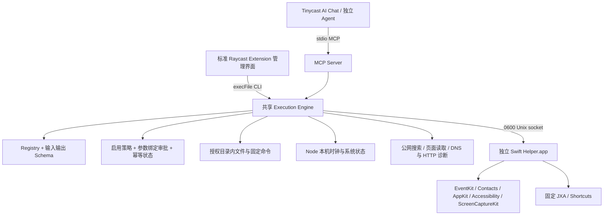

# 架构与接口



Registry 是工具名、语义、输入、输出、权限、风险、版本和 Adapter 的单一来源。MCP `tools/list` 和管理界面使用相同 Registry；所有实际调用进入同一 Engine。Tinycast JavaScriptCore 不支持 net/tls，因此扩展只调用 `child_process.execFile`，而 socket/MCP 由安装器复制的真正 Node 运行时处理。

Helper bundle ID：`com.cano.macos-agent-bridge.helper`。通过 LaunchServices 启动 app，不将普通 Node 子进程当作 TCC 身份。Helper 的签名、usage descriptions 和 Hardened Runtime entitlements 随构建封装。日历/提醒事项权限实机验证归属于该 Helper。

每个 MCP Client 按需启动自己的 stdio 进程。配置、审批与幂等收据通过本机文件锁协调；原生 Helper 使用 `flock` 保证单实例。Raycast/Tinycast 的命令卸载不影响 Helper，也不影响其他 Agent 已启动的 MCP 进程。

所有工具返回：

```json
{"status":"ok|error|confirmation_required","tool":"stable_name","version":"1.0.0","data":{},"error":null}
```

每个工具有独立的 `data` Schema，执行器也校验输出。错误对象包含稳定 `code`、可读 `message` 和可选结构化 `details`。MCP 同时提供 text JSON 和 `structuredContent`；仅 error 结果标记 `isError`，避免 Agent 将审批或失败当作完成。

工具参数兼容版本为 1.0.0，工程版本为 0.2.0；破坏性参数/语义变化必须增加工具版本，并提供迁移说明，不能静默改变既有工具。

`system_status` 由 Node runtime 直接读取本机时钟与系统信息，不依赖 Helper 或网络。处理相对日期时使用其 `localDate`、带偏移的 `localTime` 和 IANA `timezone`。联网错误保留可用的底层错误码与处理建议；瞬时连接错误最多尝试三个已验证公网 IP，共用原有总超时。系统 DNS 失败或答案含非公网地址时，可回退到固定 IP 引导的 HTTPS DNS；所有回退地址重新验证，仍禁止内网。诊断、关闭方式与隐私边界见[日期与联网故障排查](NETWORK-TROUBLESHOOTING.md)。

时间参数要求 ISO 8601 UTC offset 和明确 IANA timezone。日历范围≤366天；自由时段算法合并繁忙区间，不推断工作时间或跨日业务规则。普通事件更新/删除使用 `.thisEvent`，重复事件系列操作未作为支持能力。

环境变量仅供开发测试：`BRIDGE_STATE_DIR` 隔离策略状态；`BRIDGE_HELPER_APP` 指定自建Helper。生产Helper固定自己的用户目录，不能通过这两个变量把任意私有数据库暴露为工具。
